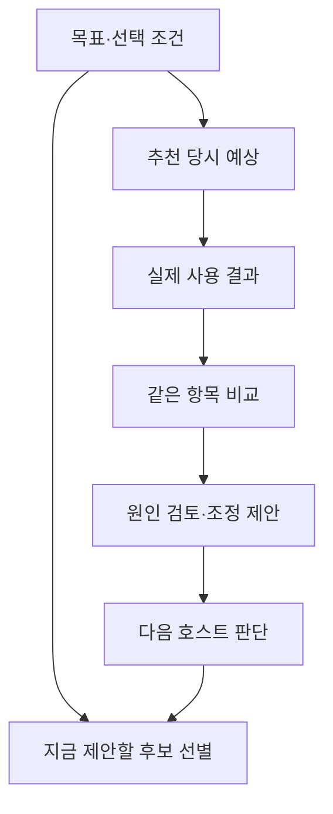

# JH 목표·예상·결과 연결과 현재 제안 선별

**목표와 선택 조건을 기록하고, 추천 당시 예상과 실제 결과를 비교한 뒤, 현재 도움이 될 제안을 고르는 호스트 모듈**이다. 기존 공개 자료 조사 1.20과 개인화 1.21에 연결되는 1.22 보완 기능이다.

Reflexion의 행동·관찰·반성 구분, DSPy의 평가 근거 연결, Timefold 예제의 필수 조건·부담·시점 분리를 참고했다. 고정 커밋·라이선스·실제 함수는 [SOURCES.md](./SOURCES.md)에 기록했다. 외부 구현이나 패키지를 편입하지 않았으며, 이 모듈을 강화학습·모델 훈련·새 최적화 알고리즘으로 표현하지 않는다.

## 무엇을 연결하는가



이전 개인화는 “어떤 기준을 중요하게 여기는지”를 다룬다. 이번 기능은 **그 기준으로 무엇을 이루려 했고, 예상했던 결과가 실제로 나왔는지**를 연결한다. 비교만으로 취향이나 원인을 자동 확정하지 않는다.

| 단계 | 남기는 내용 | 다음 단계에서의 쓰임 |
| --- | --- | --- |
| 목표 | 목표, 이유, 적용 범위, 우선순위, 필수 조건, 유효기간 | 이번 선택에 필요한 기준 |
| 예상 | 당시 목표의 스냅샷과 항목별 예상 범위 | 나중에 결과를 비교할 기준 |
| 결과 | 같은 항목의 실제 값 또는 미확인 값, 출처, 보고 방식 | 예상과 실제의 차이 확인 |
| 검토 | 차이에 대한 원인 후보·설명·조정 제안·근거 | 다음 판단에서 검토할 자료 |
| 현재 제안 | 목표·실행 준비·근거·이득·부담·시점 | 지금 표시할 제안과 보류 이유 |

## 목표와 조건을 사용할 때

사용자가 명시한 목표는 `basis: user_explicit`로 기록한다. 호스트가 추정한 목표는 `basis: host_inferred`이며 제안 상태에 남긴다. 추정한 목표를 사용자가 확정한 활성 목표처럼 사용하지 않는다.

목표에는 주제·프로젝트·측면의 범위, 기준별 방향과 가중치, 필수 조건을 연결한다. 목표를 바꾸면 이전 목표와의 관계를 기록하며, 과거 추천의 스냅샷을 새 목표로 덮지 않는다. 보류·종료·만료된 목표는 지금 제안할 후보를 선택할 때 먼저 확인한다.

제안 상태나 일시 정지에서 활성 상태로 바꾸려면 사용자의 명시적 근거가 필요하다. 완료·제외·대체된 목표는 최종 상태이므로 과거 이벤트를 다시 보내 되살리지 않는다. 유효기간에 도달하면 조회 결과에서 만료로 판단하며, 읽기 함수가 저장된 상태를 몰래 변경하지 않는다.

기존 개인화의 `rank`와 연결할 때는 유효한 목표의 우선순위·필수 조건을 **현재 호출의 context**로 전달한다. 기존 개인 선호 상태를 수정하지 않는다. “이번에는 설치 단계를 줄이고 싶다”는 목표가 모든 분야의 장기 성향이나 짧은 답변 선호로 바뀌지 않는다.

읽기 전용 연결 함수 `JHDecisionContext.rankWithGoal`은 두 상태의 소유자가 일치하는지 확인한다. 이번 대화의 명시적 조건은 같은 목표 기준보다 우선하고, 나머지 목표 조건은 유지한다. 활성 목표가 아니면 순위를 반환하지 않으며 과거 결과의 검토 자료만 별도로 확인할 수 있다.

## 예상과 실제 결과를 비교할 때

예상은 항목 `key`, 단위 `unit`, 하한 `min`, 상한 `max`로 보존한다. 실제 결과는 같은 항목·단위의 `value`를 연결한다. 결과가 없으면 `null`로 기록한다. 아직 사용하지 않은 후보에 실제 결과를 채워 넣지 않는다.

예상 이득·부담의 설명과 불확실성도 당시 기록에 보존한다. 수치 범위는 최소 한쪽 경계가 있어야 하며, 양쪽 경계가 있으면 하한이 상한보다 클 수 없다. 정성적인 설명을 실제 측정값으로 바꾸지 않는다.

결과의 출처는 사용자 보고(`user_report`)와 호스트 확인(`host_verified`)을 구분한다. 이 값은 입력을 만든 호스트가 책임지고 지정해야 한다. 런타임이 사용 현장을 직접 관찰하거나 진실성을 검증한 것은 아니다.

예를 들어 **합성 사례**에서 설치 시간이 5~10분일 것으로 예상했고 실제 보고가 18분이었다면, 비교는 실제 값이 예상 범위보다 길었다는 점을 보여 준다. 그 사실만으로 도구 정보가 틀렸는지, 조건이 바뀌었는지, 실행 중 문제가 있었는지까지 단정하지 않는다.

해당 예상에 없는 항목이나 단위가 다른 관찰은 입력을 거부한다. 단위를 임의로 변환해 비교하지 않는다. 관찰 누락과 `value: null`은 미확정으로 남기며 성공·실패 점수로 바꾸지 않는다. 수치 차이는 만족도, 통계적 유의성, 원인 증명의 대용물이 아니다.

비교 결과의 `overall`은 다음처럼 구분한다.

| 값 | 의미 |
| --- | --- |
| `matched` | 모든 예상 항목을 알고 있고, 실제 값이 경계를 포함한 예상 범위 안에 있음 |
| `missed` | 확인된 항목 중 적어도 하나가 예상 범위 밖에 있음. 다른 항목이 미확정이어도 유지 |
| `partial` | 확인된 항목은 범위 안이지만 미확정 항목이 남아 있음 |
| `unknown` | 확인된 실제 값이 하나도 없음 |

항목별 `delta`는 범위 안이면 0, 범위 밖이면 벗어난 경계와의 부호 있는 차이, 미확정이면 `null`이다. 위 합성 예시에서는 상한 10분과 실제 18분의 차이인 `+8`분이다.

## 검토한 경험을 다음 판단에 연결할 때

검토에는 다음 원인 후보 중 하나와 설명·조정 제안을 기록한다.

- `candidate_information`: 후보 정보에 관한 문제.
- `priority_interpretation`: 중요 조건의 해석 문제.
- `context_changed`: 현재 조건의 변화.
- `preference_changed`: 선호의 변화.
- `execution_issue`: 실제 실행 과정의 문제.
- `unknown`: 원인을 아직 모름.

검토자가 해석한 내용은 `reviewed_inference`, 사용자가 명시한 내용은 `user_explicit`로 구분한다. 원인 후보와 조정 제안은 관찰값 자체가 아니다. 검토 결과만으로 영구 선호를 쓰거나 과거 예상·관찰을 고치지 않는다.

`review-context`는 **정확히 같은 범위**의 과거 결과·비교·검토를 묶어 다음 호스트 판단에 제공한다. 다른 프로젝트의 실패를 현재 후보에 자동 감점하지 않으며, 한 번의 경험을 보편적인 성향으로 확대하지 않는다. 호스트는 이 자료의 출처와 불확실성을 보고 다음 판단을 결정한다.

대체된 옛 목표에서 나온 경험도 범위가 정확히 일치하면 포함하되, 현재 목표와 당시의 목표 스냅샷을 따로 반환한다. 기본적으로 최신 결과 3개를 제공하고 최대 10개까지 요청할 수 있다. 항목별 검토는 최신 10개까지 제공하며 생략한 수를 표시한다. 목록에 나온 조정 제안이 이미 적용되었다는 뜻은 아니다.

## 지금 제안할 후보를 고르는 방법

먼저 필수 조건을 검사한다. 목표가 현재 유효한지, 후보가 해당 목표에 연결되는지, 준비 단계가 `ready`인지, `eligible`이 참인지, 근거와 필요한 수치가 있는지를 확인한다. 사용자가 보류한 목표나 준비되지 않은 후보는 높은 예상 이득으로 통과시키지 않는다.

`eligible`은 호스트가 관련 목표 조건을 확인했다는 표시다. 제안의 이득·부담 숫자만으로 임의의 목표 조건을 검사할 수는 없으며, 런타임이 별도의 자격 증거를 만들어 주지도 않는다. 모르는 경우에는 `null`로 남기고 보류한다.

이 검사를 통과한 후보에는 다음 **명시적인 선택 규칙**을 적용한다.

```text
점수 = 이득 × 확신도
     - 0.25 × 초기 준비 부담
     - 0.25 × 지속 부담
     - 0.25 × 방해 정도 × 현재 상황 계수
```

현재 상황 계수는 `busy` 2, `normal` 1, `explore` 0.5다. 이 값들은 제안 표시를 위한 정책 값이며 측정된 개인 효용이나 성공 확률이 아니다. 이득·확신도·부담·방해 정도도 출처 있는 호스트 입력이다. 모르는 수치를 0으로 채워 제안이 유리해지게 만들지 않는다.

다섯 수치는 각각 `0..1` 또는 `null`이다. 숫자가 모두 알려진 후보만 점수를 계산한다. 출력에는 `scoreKind: caller_supplied_expected_utility`, `effectivenessVerified: false`를 유지한다.

점수가 0 이하인 후보는 보류한다. 기본적으로 제안은 1개를 선택하고, `explore`에서만 최대 3개까지 허용한다. 선택되지 않은 후보의 이유도 반환한다. 제안을 선택했다는 것은 설치·실행·구매·배포를 수행했다는 뜻이 아니다.

`turn`은 제한된 한국어 표현을 명시적 규칙으로 처리하는 현재 대화 도우미다. 작업 ID가 있는 “계속”, “했어”, “별로”, “나중에”, “중지”와, 구체적인 대기 질문이 있는 “그래/응/네” 등을 구분한다. “했어”는 사용자의 완료 보고이고 외부 검증은 아니며, “별로”만으로 불만의 원인을 확정하지 않는다. “나중에”에서 예약 시각을 만들어 내지 않는다.

필요한 작업·질문 문맥이 없으면 `context_required`, 인식 목록 밖 문장은 `host_interpretation_required`로 반환한다. 물음표를 보존하므로 “했어?”를 완료 보고로 취급하지 않는다. 짧은 말투·시간대·감정 표현만으로 성격이나 기분을 추정하지 않는다.

이 함수는 상태나 영구 선호를 저장하지 않는다. 실행 권한 관련 반환값은 이 모듈 자체의 효과를 나타내며, 사용자가 이미 허용한 기존 작업의 승인을 취소하거나 재확인을 요구하는 의미가 아니다. 별도 상시 프로세스나 예약 실행기는 포함하지 않는다.

## CLI 사용

Node.js 24에서 실행하며 입력은 JSON 파일 또는 표준 입력이다. 정확한 필드 계약은 `runtime-contract.md`에 둔다.

```sh
node host-decision-learning/cli.mjs --help
node host-decision-learning/cli.mjs validate --store /absolute/private/JH_Decision_Learning_v1.json --owner synthetic-owner
node host-decision-learning/cli.mjs compare --store /absolute/private/JH_Decision_Learning_v1.json --owner synthetic-owner --input comparison-request.json
```

| 명령 | 역할 |
| --- | --- |
| `init`, `validate` | 빈 상태를 명시적으로 만들거나 기존 상태를 검사 |
| `goal`, `goal-status` | 목표·조건과 명시적 상태 변경 기록 |
| `predict` | 당시 목표 스냅샷과 예상 범위 기록 |
| `outcome` | 예상에 연결되는 실제 결과 기록 |
| `review` | 결과 차이에 대한 검토 기록 |
| `compare` | 예상·실제 비교 결과 조회 |
| `context` | 유효한 목표 조건을 현재 추천의 context로 조회 |
| `review-context` | 같은 범위의 과거 결과·비교·검토 조회 |
| `select` | 현재 도움이 될 제안 후보 선별 |
| `turn` | 명시적 표현에 한정한 현재 대화 문맥 처리 |

`--store`에는 절대 경로, `--owner`에는 상태 소유자를 명시한다. 기본 저장 경로는 없다. `--input -`는 표준 입력을 사용한다. 변경 요청은 이벤트 ID·revision·원본 참조·시점을 함께 사용하며, 같은 이벤트의 정확한 재시도는 중복 기록하지 않는다.

예시 경로와 `synthetic-owner`는 설명용 값이다. 실제 대화에서 존재하지 않는 원본 참조나 사용자 평가를 만들어 채우지 않는다. 파일 저장 성공과 개인 Library에 다시 저장된 성공은 구분해 확인한다.

## 저장과 배포 경계

실제 개인 기록은 개인 Library의 비공개 **`JH_Decision_Learning_v1.json`**에 보관하며 호스트가 읽기·검증·저장 확인을 맡는다. 개인 목표·결과·대화 참조를 Git에 올리지 않는다. 기존 메모리야 Google Drive, 작업 경험 기록, 개인화·조사 상태 경로를 이 기능으로 대체하지 않는다.

상태 상한은 2MiB, 읽기 함수의 전체 출력 상한은 512KiB다. 초과하면 근거를 조용히 삭제하지 않고 오류를 반환한다. 이력 조회에서 표시 개수를 줄여도 원본 상태의 사건을 삭제하지 않는다. 상세 레코드 한도는 계약 문서에 명시한다.

| 경로 | 역할 |
| --- | --- |
| `runtime.js`, `runtime-contract.md` | 순수 상태 전이·비교·선별과 입력 계약 |
| `personalization-adapter.js` | 기존 개인화에 현재 목표 조건과 과거 검토 자료를 전달하는 읽기 전용 연결 |
| `cli.mjs` | 명시적인 비공개 로컬 파일 어댑터 |
| `*.test.mjs` | 합성 사례를 이용한 상태·연결·선별 검증 |
| `SOURCES.md` | 고정된 공개 코드 출처와 적용·제외 이유 |
| `plugin-overlay/` | **1.22** 호스트 기능을 추가하는 증분 오버레이 |
| `../host-personalization/` | 기존 **1.21** 원본 보존 |
| `../host-proactive-research/` | 기존 **1.20** 원본 보존 |
| `../host-client-plugin-overlay/` | 기존 **1.19** 감사 대상 보존 |

소스가 준비되었다는 사실만으로 현재 설치된 플러그인의 활성화나 실제 사용 후 효과가 확인된 것은 아니다. 기존 메모리 용량 확대도 이 작업에 포함하지 않는다.

## 검증 범위

```sh
node --test host-decision-learning/*.test.mjs
```

검증은 합성 목표·예상·관찰·후보만 사용한다. 목표 스냅샷 보존, 없는 결과를 미확정으로 다루는지, 비교와 원인 해석의 구분, 현재 상황과 영구 선호의 분리, 제안의 필수 조건·부담·시점·개수 제한, 저장과 재시도 동작을 확인한다.

통과한 테스트 수와 실제 실행 결과는 해당 검증 기록으로 보고한다. 사용자가 실제로 더 만족했거나 시간이 절약되었다는 결론은 사용자 평가나 측정 결과를 얻기 전에는 내리지 않는다.
