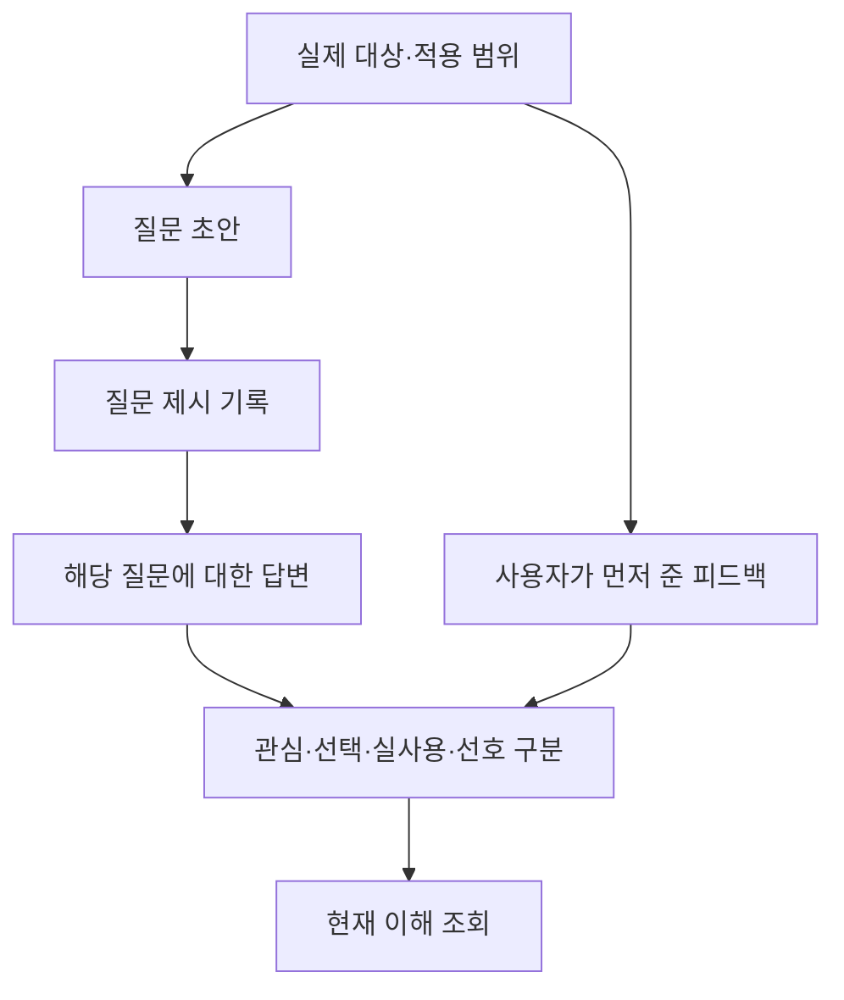

# JH 개인 대화: 먼저 묻는 질문과 자발적 피드백

**JH가 먼저 “이런 방식은 어떠세요?”라고 묻는 흐름과, 사용자가 먼저 알려 주는 피드백을 함께 보존하는 호스트 모듈**이다. 질문을 계획한 것, 실제로 제시한 것, 답을 받은 것을 구분하고 답변을 정확한 대화·대상·단계에 연결한다.

새 오버레이 버전은 **1.23.0**이다. 기존 개인화·목표 비교 기능의 원본을 수정하지 않는다. LangGraph의 interrupt ID·thread 연결과 Rasa의 현재 form·requested slot 구분을 참고했으며, 고정 코드·라이선스·제외한 동작은 [SOURCES.md](./SOURCES.md)에 기록했다. 새 모델, 강화학습, 외부 패키지 의존성, 만족도 향상에 관한 주장은 포함하지 않는다.

## 두 가지 대화 흐름



질문에 답하는 피드백은 `elicited`, 사용자가 자발적으로 알려 주는 피드백은 `spontaneous`다. 둘 중 하나를 더 신뢰하거나 더 중요한 자료로 취급하지 않는다. 자발적 피드백도 정상적인 근거이며, 이를 받기 위해 가짜 질문이나 질문 제시 기록을 만들지 않는다.

자연어의 의미를 구분하는 일은 실제 대화를 읽는 호스트가 맡는다. 런타임에는 자연어 분류 모델이나 감정 추정기가 없다. 호스트가 정리한 입력도 정확한 대상·단계·출처 검사를 통과해야 한다.

## 질문의 준비·제시·응답을 분리한다

| 상태 | 의미 |
| --- | --- |
| `draft` | 아직 제시하지 않은 질문 후보 |
| `asked` | 실제 질문 메시지를 내보내려 한 호스트 기록이 있음 |
| `answered` | 해당 질문에 연결되는 사용자 답변을 기록함 |

`asked`는 메시지 전달 시도 기록이다. `userReadVerified: false`를 유지하므로 사용자가 읽었거나 동의했다는 증거로 해석하지 않는다. 답변이 보류이면 `deferred`, 거절이면 `dismissed`로 끝나며 이 버전에서는 같은 질문을 다시 열지 않는다.

질문 종류는 세 가지다. `proposal`은 방법 제안과 선택 전 반응을 묻고, `experience`는 실제 사용 경험을 묻고, `clarification`은 불확실한 내용을 확인한다. 제안 질문에 관심을 보인 답을 사용 후 만족 평가로 기록할 수 없다.

호스트는 왜 묻는지에 대한 이유, 제안 내용, 질문 문장을 작성한다. 같은 대상의 기존 피드백에 근거했다면 그 기록도 연결한다. 런타임은 문장을 생성하는 대신 이 초안의 근거와 대화 상태를 보존하고, 지금 제시할 수 있는 질문을 고른다.

### 질문을 더 만들기 전에 확인하는 것

같은 **대상 ID·대화 ID·질문 종류**의 질문은 새 ID를 붙여 반복 생성할 수 없다. 이미 답한 질문도 이 중복 검사에 포함된다. 실제로 새로운 결정이라면 새 대상을 기록할 수 있지만, 같은 질문을 반복하려고 가짜 대상을 만들지는 않는다.

한 대화에서 답을 기다리는 질문은 한 번에 하나다. 다른 범위의 질문이라도 같은 대화에서 이미 `asked` 상태이면 새 질문 제안을 잠시 막는다. 이때 기존 질문의 원래 대상과 범위를 그대로 표시한다. 다른 대화의 대기 질문은 현재 대화에 노출하지 않는다.

`planQuestion`은 대화·범위가 맞는 가장 오래된 초안을 제안한다. 질문을 자동 전송하거나 상태를 바꾸지 않는다. 호스트가 현재 대화를 검토해 실제로 질문을 제시할 때만 `markAsked`를 기록한다. 이 큐는 예약 실행기가 아니며 이미 허용된 다른 작업의 승인을 다시 받으라는 장치도 아니다.

### 대화가 바뀌어 질문을 접을 때

현재 대화에 더 이상 필요하지 않은 초안이나 대기 질문은 `parkQuestion`으로 `parked` 상태에 둘 수 있다. 정확히 같은 대화의 질문에만 적용하며 `basis: host_context_change`와 이유를 남긴다. 질문을 접기 위해 사용자가 싫어했다거나 답했다는 피드백을 만들지 않는다.

대기 질문을 접으면 그 대화에서 다른 초안을 제시할 수 있다. 접은 질문을 자동으로 다시 묻지는 않으며 기존 중복 방지도 유지한다. 사용자가 직접 “나중에”라고 답한 경우의 `deferred`와, 호스트가 문맥 때문에 접은 `parked`는 별개의 사건이다.

## 관심·선택·사용 후 평가를 구분한다

| 단계 | 예시의 의미 | 기록 범위 |
| --- | --- | --- |
| `considering` | 관심 있음, 선택함, 거절함, 보류함, 불확실함, 변경 요청 | 검토·선택 과정 |
| `experience` | 좋았음, 장단점이 있었음, 나빴음, 불확실함, 아직 안 씀 | 실제 사용 경험 또는 미사용 |
| `preference` | 명시적 선호 확인, 정정, 불확실함 | 해당 기준의 선호 상태 |

“비교해 보자”는 관심이나 검토 의향일 수 있고, “B로 할게”는 선택일 수 있다. 두 표현만으로 실제 사용이나 만족을 기록하지 않는다. 사용 후 긍정·혼합·부정 평가에는 `useEvidenceRef`가 필요하다. 아직 사용하지 않았다는 `not_used`에는 사용 근거를 붙이지 않는다.

`afterUseReported`는 사용자에게서 실제 사용 후 보고를 받았다는 표시이며 현장 검증을 뜻하지 않는다. 입력의 `sourceAuthority: user_explicit` 역시 호스트가 실제 사용자 표현에 근거해 기록했다는 뜻이다. 런타임이 그 말의 진실성을 독립적으로 확인하지는 않는다.

### 질문에 대한 답변 연결

`elicited` 답변은 존재하는 `asked` 질문과 대상 ID·대화 ID가 정확히 일치해야 한다. 제안 질문은 `considering`, 경험 질문은 `experience` 답변을 받는다. 확인 질문은 세 단계 중 해당하는 답변을 받을 수 있다. 초안이나 이미 종료된 질문에 새로운 답변을 붙이는 요청은 거부한다. 이미 처리된 같은 이벤트의 정확한 재전송만 멱등 재시도로 받아들인다.

`spontaneous` 피드백은 `questionId: null`로 실제 대상에 기록한다. 같은 대화에 다른 대기 질문이 있더라도 그 질문을 임의로 답변 완료 처리하지 않는다.

## 지금 JH가 이해한 내용을 조회한다

`dialogueContext`는 정확히 같은 주제·프로젝트·측면 범위의 근거를 읽는다. 범위 값은 명시적인 식별자이며 문구가 비슷하다는 이유로 자동 합치지 않는다.

| 조회 항목 | 포함되는 내용 |
| --- | --- |
| `items` | 같은 범위의 최신 피드백. 두 route를 동등하게 포함하고 각 원본 대화·출처·단계를 유지 |
| `knownPreferences` | `preference` 단계이면서 `ongoing`인 최신 확인·정정 기록 |
| `unresolvedPreferences` | 같은 기준의 최신 `ongoing` 기록이 미확정인 경우 |
| `currentTaskPreferences` | `preference` 단계이면서 `this_task`인 현재 대화의 조건. 미확정이면 그대로 표시 |
| `pendingQuestion` | 현재 대화에서 답을 기다리는 질문과 그 원래 대상 |
| `draftQuestions` | 현재 대화·정확한 범위에 맞는 질문 초안 |
| `recentQuestions` | 현재 대화·정확한 범위의 최근 질문 상태와 호스트가 접은 이유 |

`items`에는 같은 범위의 여러 대화에서 나온 근거가 포함될 수 있다. 반면 이번 작업의 조건인 `currentTaskPreferences`는 현재 대화에 한정한다. `pendingQuestion`은 현재 대화에서 새 질문을 막는 항목이므로 조회 범위와 다를 수 있지만, 그 원래 범위를 바꾸어 표시하지 않는다.

선호별 최신 기록이 미확정이면 오래된 확인 기록을 되살리지 않는다. 관심, 선택, 좋은 사용 경험, 적용 범위 `unspecified`인 기록은 근거로 남지만 장기 선호로 자동 승격하지 않는다. 설치 편의성에 대한 말을 답변 길이 선호나 다른 분야의 취향으로 확대하지 않는다.

선호 보기는 표시된 `items` 일부가 아니라 해당 범위의 전체 저장 근거를 사용한다. 최신 피드백 표시는 기본 5개·최대 10개, 질문 초안 표시는 최대 10개, 최근 질문 표시는 최대 5개이며 각각 생략 수를 알린다. 접은 이유도 사용자 답변과 구분해 조회한다. 이 조회는 기존 개인화의 순위나 프로필을 다시 쓰지 않는다.

## 소스 연결과 저장

대상에는 `personalization`, `decision_learning`, `proactive_research`의 외부 ID를 참조할 수 있다. `externalRef`는 호스트가 연결한 참조이며, 이 모듈이 외부 저장소의 해당 레코드를 조회·검증했다는 뜻은 아니다. 실제 질문·응답·사용 근거에는 다시 찾을 수 있는 원본 참조를 사용한다.

개인 상태 파일은 개인 Library의 비공개 **`JH_Personal_Dialogue_v1.json`**이다. 호스트가 읽기·검증·저장 확인을 맡으며 대화·선호·개인 평가를 공개 Git에 올리지 않는다. 기존 1.22 이하 상태·저장 경로·메모리 한도는 변경하지 않는다.

상태는 최대 2MiB, 읽기 결과는 최대 512KiB다. 초과하면 오류를 반환하며 근거를 조용히 삭제하지 않는다. 구체적인 레코드 한도와 필드는 [runtime-contract.md](./runtime-contract.md)에 명시한다.

## CLI

Node.js 24에서 실행한다. 기본 저장 경로는 없으며 `--store`에 절대 경로, `--owner`에 소유자를 지정한다. `--input`으로 JSON 파일을 읽거나 `--input -`로 표준 입력을 사용할 수 있다.

```sh
node host-personal-dialogue/cli.mjs --help
node host-personal-dialogue/cli.mjs validate --store /absolute/private/JH_Personal_Dialogue_v1.json --owner synthetic-owner
node host-personal-dialogue/cli.mjs plan --store /absolute/private/JH_Personal_Dialogue_v1.json --owner synthetic-owner --input plan-request.json
```

| 명령 | 역할 |
| --- | --- |
| `init`, `validate` | 최초 상태 생성 또는 기존 상태 검증 |
| `subject` | 실제 대상·범위·출처와 외부 참조 기록 |
| `question` | 질문 초안 기록 |
| `asked` | 실제 질문 메시지의 전달 시도 기록 |
| `feedback` | 자발적 피드백 또는 정확한 질문에 연결되는 답변 기록 |
| `park` | 문맥 변화로 질문을 접고 호스트의 이유 기록 |
| `plan` | 현재 대화에서 제시할 질문 후보 조회 |
| `context` | 현재 이해·미확정·이번 작업 조건·질문 상태 조회 |

변경에는 `expectedRevision`, 이벤트 ID, `sourceRef`, `at`가 필요하다. 같은 ID·같은 내용의 재시도는 중복 기록하지 않으며, 오래된 revision의 새로운 변경이나 같은 ID의 내용 변경은 거부한다. 상태는 불변 사건을 재생해 검증한다.

위 경로와 소유자는 합성 예시다. 실제 평가나 질문 메시지를 만들어 넣지 않는다. 로컬 파일 갱신과 Library 저장 성공은 각각 확인해야 한다.

## 파일과 검증 경계

| 경로 | 역할 |
| --- | --- |
| `runtime.js`, `runtime-contract.md` | 질문·피드백 상태 전이와 조회 계약 |
| `cli.mjs` | 명시적 비공개 로컬 파일 어댑터 |
| `SOURCES.md` | 고정 공식 코드·라이선스·적용과 제외 이유 |
| `*.test.mjs` | 합성 대화·대상·답변으로 검증 |
| `plugin-overlay/` | 1.23.0의 호스트 지침과 배포용 파일 |

```sh
node --test host-personal-dialogue/*.test.mjs
```

검증에서는 두 피드백 경로, 대화·대상·단계 불일치, 질문 초안과 제시의 구분, 중복 질문·중복 답변, 사용자 답변 없이 문맥상 질문 접기, 미사용과 실제 사용 보고, 최신 미확정 선호, 현재 작업 범위를 확인한다. 통과 수는 실제 실행 결과에 따라 보고한다.

코드와 합성 검증만으로 사용자의 만족이나 효과가 확인되지는 않는다. 이 모듈은 호스트가 실제 대화에서 얻은 근거를 정확히 연결해 사용하도록 돕는다. 플러그인이 현재 설치 환경에 활성화되었는지와 개인 상태가 저장되었는지도 별도 근거로 확인한다.
