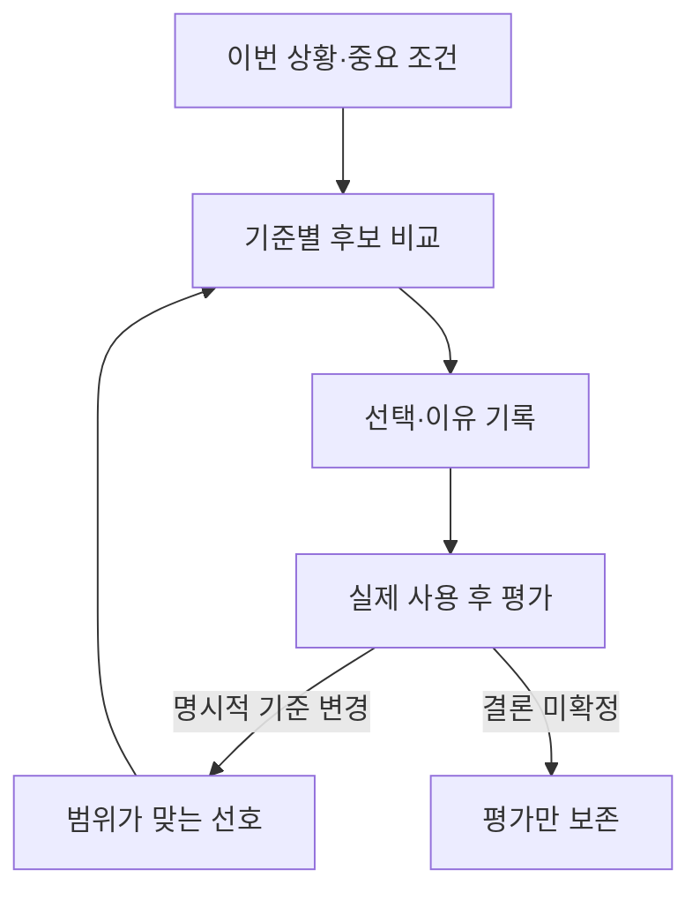

# JH 상황별 개인 선택·평가

**이번 상황의 중요 조건, 선택한 이유, 실제 사용 후 평가를 연결해 다음 추천의 순위를 설명할 수 있게 하는 호스트 모듈**이다. 같은 사용자라도 상황과 분야가 달라지면 다른 기준을 적용한다. 미확정 취향을 확정된 성향으로 채우지 않는다.

공개 오픈소스에서 기억의 범위와 정정 이력을 참고했으며, 추천 점수는 별도로 구현한 결정론적 규칙이다. 모델 가중치를 훈련하거나 감정을 추정하는 기능은 없다. `runtime.js`는 네트워크·파일시스템을 사용하지 않고, 연결된 호스트가 실제 대화 해석과 비공개 상태 저장을 맡는다.

## 대화에서 달라지는 점

사용자가 어떤 도구를 고를 때 JH는 이번 목표와 중요한 조건을 먼저 적용한다. 사용자가 선택하면 선택한 후보와 이유를 연결해 둔다. 이후 사용자가 실제로 써 본 평가와 다음 선택에 적용할 기준을 말하면, 그 기준이 다음 추천에 영향을 준다.



“오늘은 급하니 설정이 쉬운 것을 골라줘”는 이번 비교의 우선순위로 사용할 수 있다. 이 말만으로 모든 상황에서 설정 편의성을 최우선하는 장기 선호를 만들지는 않는다. `context.mode`에 상황 이름을 적는 것만으로 순위가 바뀌지도 않는다. 호스트가 현재의 명시적 조건을 `priorities`와 `constraints`로 전달해야 한다.

“설치가 간편한 것이 좋다”는 설치 기준에 관한 근거다. 답변 길이, 설명 깊이, 다른 생활 분야의 취향으로 확장하지 않는다. 직업·피자·카비서 등 설명용 예시는 검증된 개인 사실로 저장하지 않는다. 사용자에게서 실제 사용 후 평가를 받지 않았다면 피드백을 미리 만들어 넣지 않는다.

## 어떤 정보를 구분하는가

| 구분 | 처리 |
| --- | --- |
| 이번 상황의 조건 | `rank` 호출의 `context`에 넣는다. 해당 호출에서만 적용하며 장기 선호를 생성하지 않는다 |
| 명시적 장기 선호 | 소유자·분야·적용 범위와 함께 `recordPreference`로 기록한다. `basis: stated` |
| 미확정 선호 | `status: uncertain`으로 남긴다. 점수에 넣지 않고 결과에서 미확정 기준으로 알린다 |
| 사용자 정정 | `revisePreference`로 대상 ID를 명시한다. 같은 범위·기준의 새 기록을 만들고 이전 기록과 연결한다. `basis: explicit_correction` |
| 선택과 이유 | `recordChoice`로 후보 ID, 당시 적용한 선호 ID, 선택 이유를 남긴다. 사용 완료나 만족으로 간주하지 않는다 |
| 사용 후 평가 | `recordFeedback`으로 선택 기록에 연결한다. `basis: after_use`는 사용자가 알려 준 실제 사용 후 평가라는 의미이며 독립적인 기기 검증을 의미하지 않는다 |
| 평가에 따른 기준 변경 | 사용자가 명시한 `updates`만 새 선호 기록으로 만든다. 평가의 범위를 다른 분야나 전체 성향으로 자동 확대하지 않는다 |

사용 후 평가의 결과는 `positive`, `mixed`, `negative`, `uncertain` 중 하나다. 결과와 요약만 남기고 `updates`를 비워 둘 수 있다. 이 경우 평가 기록은 보존되지만 점수 기준은 바뀌지 않는다. “별로였다”라는 말만으로 어떤 속성이 문제인지 추정하거나 해당 후보에 영구 감점을 부여하지 않는다.

`updates`에 넣는 `preferenceId`는 새로 만들 기록의 ID다. 적용 범위는 평가한 선택에서 상속되며 각 항목은 `explicit: true`를 요구한다. 이 값은 호스트가 실제 사용자 표현을 확인한 후에만 지정한다.

## 적용 범위와 우선순위

범위 `scope`에는 `topic`이 필요하고 `project`, `aspect`를 선택적으로 넣을 수 있다. 값은 호스트가 정규화한 식별자다. 선언한 차원은 현재 범위와 정확히 일치해야 한다. 생략한 차원은 그 안에서 더 넓게 적용된다. 문자열이 비슷하다는 이유로 다른 주제를 자동 합치지 않는다.

같은 기준에 여러 기록이 있으면 다음 순서로 선택한다.

1. 현재 `rank` 호출에서 지정한 우선순위가 해당 기준을 이번 호출에 한해 덮는다.
2. 지속 선호끼리는 적용 범위가 더 구체적인 기록을 먼저 선택한다.
3. 같은 구체성에서는 명시적 정정과 사용 후 평가에 따른 명시적 변경을 같은 우선 단계로 다루며, 둘 다 일반 진술보다 우선한다.
4. 같은 우선 단계에서는 최신 근거를 선택한다. 사건 시각이 같으면 이벤트 revision으로 순서를 정한다.

따라서 과거 정정이 더 최근의 명시적인 사용 후 평가를 영구적으로 막지 않는다. 이후 사용자가 다시 정정하면 그 최신 정정이 적용된다.

가장 우선하는 기록이 미확정이면 그 기준은 미확정으로 보고한다. 과거의 확정 선호를 대신 가져와 확신 있는 추천처럼 만들지 않는다.

선택 이유에는 당시 유효하고 적용 가능한 지속 선호 ID를 연결할 수 있다. 확정·미확정 여부는 그대로 유지한다. 이번 호출에만 쓰인 조건은 장기 선호 ID가 없으므로 선택의 `reason`에 이유를 남긴다. 이후 취향이 정정되어도 과거 선택이 참조한 원래 근거 ID를 바꾸지 않는다.

## 추천 점수의 의미

호스트는 후보별 특성값을 `0..1` 범위로 전달한다. 출처가 없거나 값이 확인되지 않으면 `null` 또는 누락으로 표현한다. 런타임은 웹 자료를 읽거나 특성값의 진실성을 직접 확인하지 않는다. 출력은 `featureTruthVerified: false`, `scoreKind: caller_supplied_feature_fit`로 이 한계를 드러낸다.

확정된 기준의 가중치는 1에서 5다. 높을수록 좋은 기준의 적합도는 특성값이고, 낮을수록 좋은 기준은 `1 - 특성값`이다. 모든 확정 기준의 가중치 합을 분모로 사용한다.

- **점수 하한 `score`**: 확인된 특성의 가중 적합도 합 ÷ 전체 가중치 합.
- **점수 상한 `scoreUpper`**: 확인된 가중 적합도 합에 미확인 특성의 가중치를 더한 값 ÷ 전체 가중치 합.
- **확인 범위 `coverage`**: 확인된 특성에 해당하는 가중치 합 ÷ 전체 가중치 합.

상·하한은 모르는 특성이 줄 수 있는 범위다. 통계적 신뢰구간, 만족 확률, 실제 성능 측정치가 아니다. 특성 누락이 완벽한 적합도로 처리되지 않는다.

순위는 점수 하한, 확인 범위, 안정된 후보 ID 순으로 결정한다. 확정 기준이 하나도 없으면 점수와 상한은 `null`, 확인 범위는 0이며 후보 ID 순서만 유지한다. 이 정렬을 취향을 안다는 주장으로 사용하지 않는다.

현재의 필수 조건 `constraints`에는 `gte` 또는 `lte` 비교를 사용한다. 확인된 위반은 `constraint_mismatch`, 판단에 필요한 값 누락은 `constraint_unknown`으로 비교 대상에서 제외한다. 과거 선호가 현재의 필수 조건을 덮을 수 없다.

### 합성 예시: 사용 후 평가로 순위가 바뀌는 경우

다음 값은 설명용 합성 데이터이며 사용자의 취향이나 실제 제품 성능이 아니다.

| 기준 | 후보 A | 후보 B | 처음 가중치 | 평가 후 가중치 |
| --- | ---: | ---: | ---: | ---: |
| 처리 속도: 높을수록 좋음 | 1.0 | 0.7 | 5 | 5 |
| 설치 편의성: 높을수록 좋음 | 0.2 | 1.0 | 1 | 5 |

처음에는 A가 약 0.867, B가 0.750으로 계산된다. A를 실제 사용한 뒤 사용자가 “다음에는 설치 편의성을 더 중요하게 비교해 달라”고 명시해 같은 범위의 설치 편의성 가중치를 5로 바꾸면 A는 0.600, B는 0.850이 된다. 이때 B가 위로 올라가는 이유는 **같은 상황에 적용되는 설치 편의성 기준이 바뀌었기 때문**이다.

이 예시는 직접 공개한 계산 규칙의 결과다. 답변을 짧게 만들거나, 다른 분야의 추천 기준을 바꾸거나, 모델의 성능이 향상되었다고 주장하는 근거로 사용하지 않는다.

## 런타임 API

`runtime.js`를 불러오면 `globalThis.JHPersonalization`을 제공한다. 스키마는 `jh.personalization.v1`, `apiVersion`은 `1.0.0`이다. 순수 함수는 입력 상태를 직접 변경하지 않는다.

| 함수 | 용도 |
| --- | --- |
| `createState({ownerScope, now})` | 새 소유자의 빈 상태 생성 |
| `validateState(state)` | 스키마·참조·이력 검사 후 검증된 복사본 반환 |
| `fingerprint(value)` | 입력의 안정된 지문 생성 |
| `recordPreference(state, input)` | 범위별 명시적 선호 또는 미확정 선호 기록 |
| `revisePreference(state, input)` | 같은 범위·기준의 사용자 정정 기록 |
| `recordChoice(state, input)` | 후보 선택과 선택 이유 기록 |
| `recordFeedback(state, input)` | 실제 사용 후 평가 및 명시적 기준 변경 기록 |
| `rank(state, input)` | 현재 조건과 적용 가능한 선호로 비교. 상태 변경 없음 |

변경 함수는 `{state, result}`를 반환하며 `result`에는 `changed`, `duplicate`, `revision`이 있다. 입력에 현재 `expectedRevision`, 원본을 다시 찾을 수 있는 `sourceRef`, 사건 시점 `at`가 필요하다. 소유자는 상태 생성 시 지정하며 변경할 수 없다.

같은 이벤트 ID·같은 내용은 멱등 재시도다. 같은 ID의 내용을 바꾸거나 오래된 revision으로 새로운 변경을 보내면 거부한다. `sourceRef`와 후보의 `sourceRefs`는 호스트가 해석할 수 있는 실제 원본 참조를 사용한다. 존재하지 않는 URL을 만들어 채우지 않는다.

### 호출 예시

다음 코드는 네트워크나 사용자 상태를 사용하지 않는 합성 예시다.

```js
import './runtime.js';
const P = globalThis.JHPersonalization;
const scope = { topic: 'tool-selection', project: 'synthetic-project' };
let state = P.createState({
  ownerScope: 'synthetic-owner',
  now: '2026-11-02T00:00:00.000Z',
});

state = P.recordPreference(state, {
  expectedRevision: state.revision,
  preferenceId: 'synthetic-setup-preference',
  scope,
  key: 'setup-ease',
  direction: 'higher',
  weight: 3,
  status: 'confirmed',
  reason: '설명용으로 명시된 설치 편의성 선호',
  sourceRef: 'synthetic:explicit-preference',
  at: '2026-11-02T00:00:01.000Z',
}).state;

const result = P.rank(state, {
  at: '2026-11-02T00:00:02.000Z',
  scope,
  candidates: [
    { id: 'synthetic-a', label: '합성 후보 A', features: { 'setup-ease': 0.2 }, sourceRefs: ['synthetic:feature-a'] },
    { id: 'synthetic-b', label: '합성 후보 B', features: { 'setup-ease': 1.0 }, sourceRefs: ['synthetic:feature-b'] },
  ],
  context: { mode: '설명용 비교' },
});
```

`result`에는 `ranks`, `excluded`, `effectiveCriteria`, `unresolved`, `context`, `rankingFingerprint`가 포함된다. 입력 특성의 품질과 출처 검토는 호스트 책임이며, 런타임 점수는 입력한 값과 기준의 관계를 보여 준다.

## CLI와 비공개 저장

Node.js 24 CLI는 `init`, `validate`, `prefer`, `revise`, `choose`, `feedback`, `rank` 명령을 제공한다. 입력은 JSON 파일 또는 표준 입력이다.

```sh
node host-personalization/cli.mjs --help
node host-personalization/cli.mjs validate --store /absolute/private/JH_Personal_Choices_v1.json --owner synthetic-owner
node host-personalization/cli.mjs rank --store /absolute/private/JH_Personal_Choices_v1.json --owner synthetic-owner --input ranking-request.json
```

`--store`에는 명시적 절대 경로, `--owner`에는 상태 소유자를 지정한다. `--input -`는 표준 입력을 사용한다. 최초 상태 생성에만 `init`를 사용하며 `{ "now": "ISO 시각" }`를 입력한다. 명령 성공을 원격 저장 성공으로 간주하지 않는다.

실제 운영 상태는 개인 Library의 **`JH_Personal_Choices_v1.json`**에 보관한다. 호스트가 읽기·검증·갱신·저장 확인을 수행한다. 개인 선택·평가·원본 대화 참조를 공개 저장소에 넣지 않는다. 메모리야의 기존 Google Drive 저장과 JH 작업 경험의 기존 경로는 유지한다.

이 기능은 기존 메모리 저장 용량 확대 작업이 아니다. 개인화 런타임은 제한된 JSON 상태로 동작하며, 현재 구현의 상태 크기 상한은 2MiB다. 비교 한 번에 후보 최대 20개, 후보당 특성 최대 32개, 현재 우선순위 최대 20개를 받는다. 한도를 넘으면 숨겨진 삭제나 임의 요약으로 통과시키지 않고 오류로 알린다.

## 소스와 배포 경계

| 경로 | 역할 |
| --- | --- |
| `runtime.js` | 범위·선호·선택·평가·정정·순위 계산 |
| `cli.mjs` | 명시적인 로컬 상태 파일 어댑터 |
| `*.test.mjs` | 합성 데이터 기반 동작·저장·통합 검증 |
| `SOURCES.md` | 고정 OSS 커밋·라이선스·실제 함수와 적용·제외 이유 |
| `plugin-overlay/` | **1.21.0** 개인화 증분 오버레이 |
| `plugin-overlay/skills/jh-personalization/` | 호스트 지침, 상태 연결 참조, 배포용 `scripts/runtime.js`·`scripts/cli.mjs` |
| `../host-proactive-research/` | 기존 **1.20** 공개 자료 조사·제안 기능. 원본 보존 |
| `../host-client-plugin-overlay/` | 기존 **1.19** 감사 대상. 원본 보존 |

새 오버레이에는 호스트 흐름, 상태 연결 계약, 출처와 원본 소스 지문 참조가 포함된다. 배포용 스크립트는 각 원본과 일치해야 한다. 이 소스 디렉터리가 있다는 사실만으로 사용자의 현재 플러그인에 1.21이 활성화되었다고 판단하지 않는다.

기존 공개 자료 조사 기능은 적용 가능한 자료를 찾는다. 개인화 기능은 그 결과의 후보들을 이번 상황과 확인된 선호로 비교할 수 있게 한다. 후보를 사용자 시스템에 설치·구매·배포하는 권한은 이 순위 결과에서 생기지 않는다.

## 검증과 한계

```sh
node --test host-personalization/*.test.mjs
```

검증에는 합성 후보와 합성 선호만 사용한다. 현재 조건이 지속 선호를 오염시키지 않는지, 범위가 다른 경험이 섞이지 않는지, 정정이 이전 근거를 대체하는지, 사용 후 명시적 기준 변경으로 순위가 바뀌는지, 미확정 기준·누락 특성·필수 조건·동률이 정직하게 표현되는지 확인한다.

이 테스트는 사용자에게서 받은 실제 평가나 실제 제품 성능을 입증하지 않는다. 자연어를 어느 범위와 기준으로 정리할지, 자료의 특성값을 어떻게 확인할지는 호스트의 해석·조회 단계다. 런타임은 그 입력을 명시적인 규칙으로 적용하고 이유를 추적할 수 있게 한다. 지속적인 백그라운드 관찰, 예약 실행, 감정 판단, 자동 구매·설치·모델 훈련은 포함하지 않는다.

공개 소스의 확인 범위와 라이선스는 [SOURCES.md](./SOURCES.md)를 참고한다. 외부 코드나 패키지를 직접 편입하지 않았으며, OSS의 성능 수치를 JH의 개선 결과로 사용하지 않는다.
